<p align="center"></p>

<h1 align="center">My LMU Hub</h1>

<p align="center"><b>A free pitwall dashboard and personal stats hub for Le Mans Ultimate.</b><br>
One Windows app, no SimHub, no install. Made for endurance racers, and for watching your team-mate drive.</p>

<p align="center"><a href="https://github.com/SKMots/MyLMUHub/releases/latest"><b>Download the latest release</b></a></p>

---

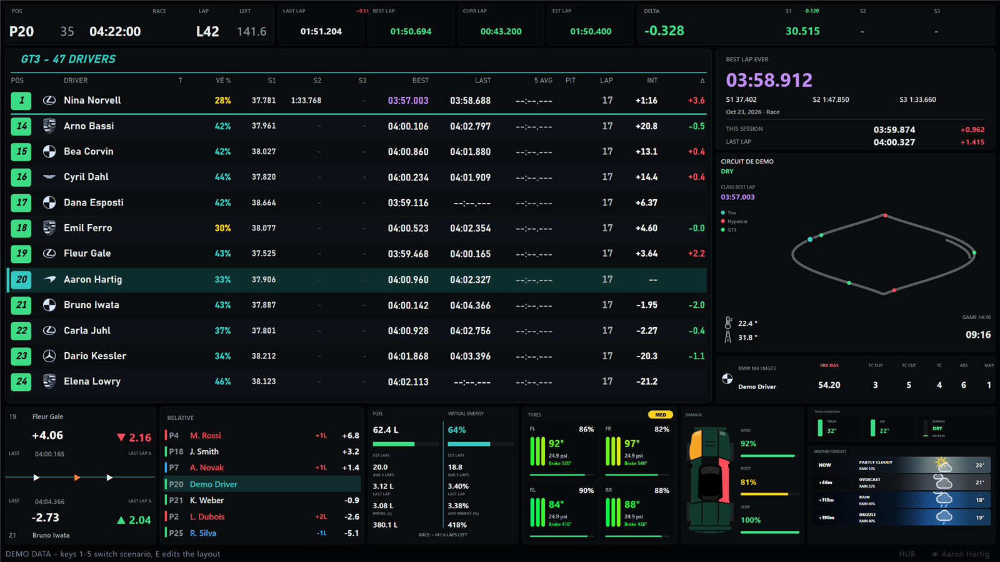

## Contents
- [Race Control: the live dashboard](#race-control-the-live-dashboard)
- [Make it your own](#make-it-your-own)
- [Race Control settings in the hub](#race-control-settings-in-the-hub)
- [The Hub](#the-hub)
- [AI Coach](#ai-coach)
- [Strategy](#strategy)
- [Team](#team)
- [On your phone](#on-your-phone)
- [Settings](#settings)
- [Guest mode and My sessions](#guest-mode-and-my-sessions)
- [Everything else](#everything-else)
- [Getting started](#getting-started)

## Race Control: the live dashboard
A full-screen dashboard for a second monitor, built from widgets. Open it on this PC or on a tablet, phone or second PC at home.

| Widget | What it shows |
|---|---|
| **Leaderboard** | One class at a time: position, driver, car logo, tyres, virtual energy %, sectors S1-S3, best, last, 5-lap average, pit stops, laps, interval and the last-lap difference, and a badge for penalties to serve (drive-through, stop-and-go, +seconds). Your car stays in the middle. You choose the number of rows, a class, and whether P1 is always shown. More leaderboards can show the other classes. |
| **Ahead / Behind** | The car in front and behind: gap, last lap, and arrows that turn green or red as you gain or lose. |
| **Top bar** | Position, race time / laps left, last / best / current / estimated lap, a live delta and sectors. |
| **Car** | Brake bias, TC, TC slip, TC cut, ABS and engine map. |
| **Fuel & virtual energy** | What's left, estimated laps, 5-lap average and last lap, and how much fuel / energy to add at the stop. **Live VE goal:** like the in-game MFD, it works out whether the VE you have left lasts the laps you aim for this stint at your average, and says **PUSH +x%**, **ON TARGET** or **LIFT x%**, with laps done / laps aimed for. The laps a stint come from the hub's Race Control page for this track, the plan you picked, or a number you type; change them by a lap while you drive with a key or wheel button. |
| **Tyres** | Each tyre's pressure, temperature and wear, plus brakes, in the units you choose. |
| **Damage** | A GT car seen from above with each body part and tyre coloured by its damage, plus aero, body and suspension with bars. The classic panel is still an option. |
| **Track map** | Learns each track by itself: cars as dots in their class colours, your car highlighted, a legend. **Flags:** a green / yellow flag box, the yellow stretch glowing on the map, and full-course yellows. |
| **Weather forecast** | Each forecast point as its own card, its background showing the weather coming (sun, clouds, rain, storm), with rain chance and temperature. The classic rows are still an option. |
| **Track condition** | Track and air temperature, coloured from cold to hot, and the surface: dry, damp or wet, and whether it's raining. |
| **Best lap ever** | Your best lap on this track and car, from all your sessions, with sectors, this session's best and the last lap. It updates the moment you beat it. |
| **Relative** | The cars around you on the road, with the gap in seconds, from the game's own timing (as the in-game relative). |
| **Race prediction** | Where everyone will finish, from each car's real race pace (cut laps and out-laps don't count), the stops they still need, and the time a pit stop costs in this race. |
| **Twitch chat** | Your channel's chat, with emotes and the viewer count. |

**Spectator mode:** when you're not in the car (you're watching your team-mate), the whole dashboard follows their car. **SPECTATE** picks any car.
When that team-mate uses My LMU Hub too (same team), the dashboard shows **their own live numbers**: exact tyres, fuel, virtual energy and damage, which the
game doesn't give a spectator. A **LIVE: name** tag in the corner says so; without it (no team, or a team-mate without the app) it works as before.

## Make it your own
Press **E** and you're in edit mode:
- **Moving and sizing:** drag, resize, push or swap widgets; they snap to each other and the edges. **Auto align** tidies up, and **Reset layout** starts over.
- **Per-widget settings:** colours, font, text size, opacity, what it shows, and **Float on top** (lies over the others).
- **Themes:** Lime, Teal, Daylight and Navy, and car logos in one colour or full colour.
- **Views:** several named views ("Race", "Qualifying", ...). Switch between them with keyboard shortcuts that work while the game has focus, or with buttons on your wheel or button box.
- **Any screen shape:** on 16:9, 4:3, ultrawide or super ultrawide your dashboard shows as you made it, scaled to fit the window. A portrait monitor gets
  its own arrangement, laid out from your main layout the first time; what you change there stays for that screen only.
- **More screens:** another window per view, or a view on another device.
- **Sharing:** export and import layouts, e.g. to pass one to a friend.

## Race Control settings in the hub
The **Race Control** tab in the hub has the dashboard's settings in one place, so you don't need edit mode for them: **Open dashboard**, your
**laps a stint per track** for the fuel widget's live VE goal (the track you're on is read from the game; pick one by hand when you're not in it), the **theme** and text size, which
**view** the dashboard shows (plus export / import) and **spectate**; folded under **Advanced**: **hotkeys** for views and for the stint laps + / − (keys or wheel buttons; they keep working in the game too) and **network access**. An open dashboard follows
your changes right away. Edit mode (E) in the dashboard keeps only what is done on the dashboard itself: placing widgets, their colours, views.

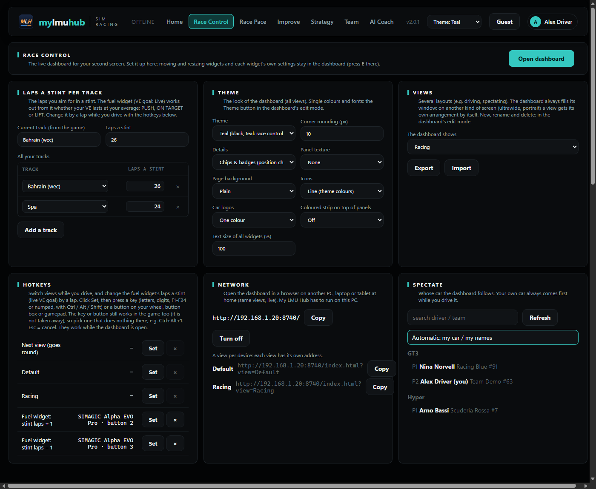

## The Hub
The menu is grouped by what you do: **Drive** (Race Control), **Analyse** (Race Pace, Improve, AI Coach), **Plan** (Endurance plan, Quick race, Live, Review)
and **Team**; your name (top right) is **Settings**. A group with more pages opens a panel with a line on what each page is for. On the first start, Home shows
**Get started** (your driver names, your result files, your team), ticked off by itself. A **?** next to terms like race pace level, virtual energy or stint
explains them in plain words. Pages keep the same layout between tabs, and grey placeholders stand in while your results are read.

| | |
|---|---|
| 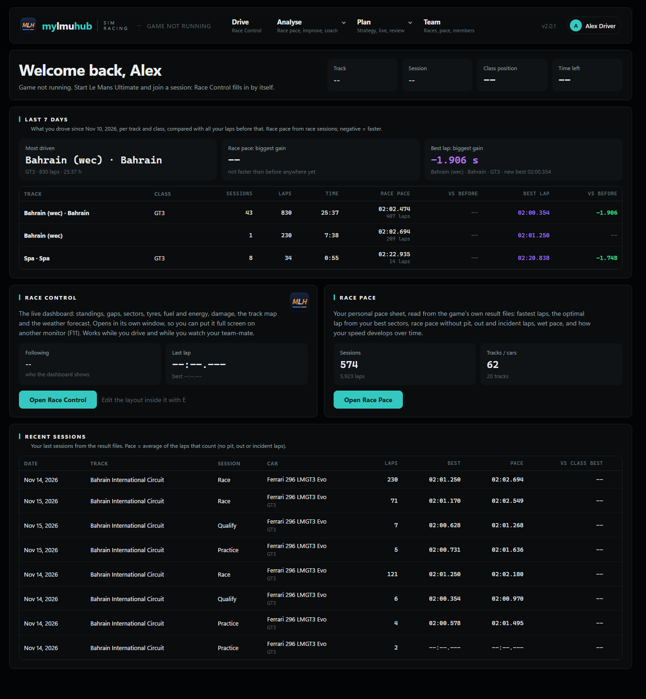 | 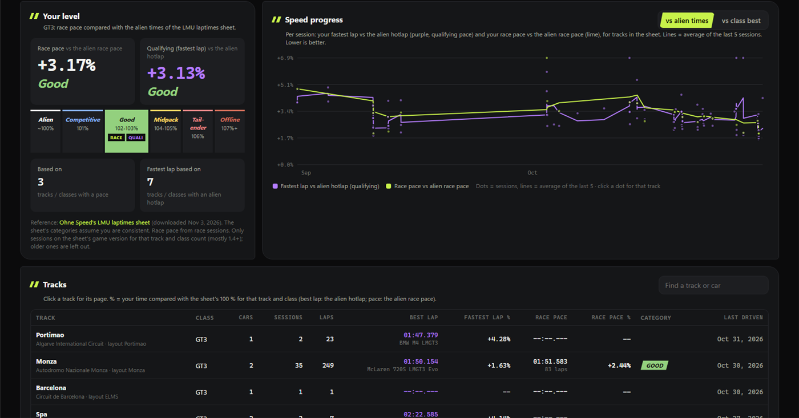 |
| **Home** | **Race Pace** |

**Home**
- The live session (track, session, class position, time left).
- **Last 7 days:** most driven track, your biggest race-pace and best-lap gains, per track and class.
- Your recent sessions, with the one you're driving marked LIVE.

**Race Pace:** your personal pace sheet, read from the game's own result files, so every session you ever drove counts from the first start.
- **Your level** per class against the community "alien" lap times: race pace and qualifying pace, in categories from Alien to Offline.
- **Speed progress** over time, against the alien times or the class best.
- **Every track** with its best lap, optimal lap (your best sectors), race pace (no pit, out or incident laps) and category. A page per track shows progress there, the alien reference and your cars.
- **Filters:** class, race / qualifying / all sessions, game version, period, and how slow a lap may be before it's left out.

**Improve** shows what to work on next, in two tabs. Filter by class, and search or pick a track and layout.

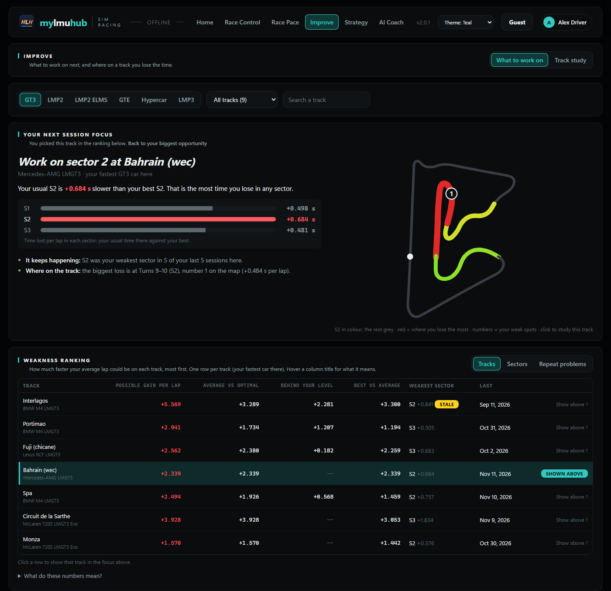

*What to work on:*
- **Your next session focus:** your biggest opportunity in plain words, e.g. "Work on sector 2 at Bahrain: your usual S2 is 0.684 s slower than your best.
  It was your weakest sector in 5 of your last 5 sessions; the biggest loss is at Turns 9-10". The map shows only that sector in colour.
- **Weakness ranking:** tracks by what there is to find per lap, every sector by what you lose there and how much it varies, and the weaknesses that keep coming back.
- **Tracks behind your level**, and stale tracks (not driven for a while).
- **Time left on the table:** your best lap against your optimal lap, and your race pace against your best lap (consistency).

*Track study:* one track and car on a big map that follows the real track, timed live while you drive.
- **Turn by turn:** the lap is split corner by corner (from braking for a corner to braking for the next one), with the circuit's official turn numbers, coloured by where you lose time or vary most. Your weak spots are the three turns that cost you the most.
- **Tips from your fastest lap:** click a spot and see how your fastest lap drove it against how you usually do, e.g. "Brake 8 m earlier", "Carry 3 km/h more through the slowest point", "6 km/h better exit".
- **Theoretical best:** your best time on every ~600 m stretch added up, a lap you can really reach.
- **Driving lines:** compare two lines on the map: your best lap, your optimal lap (your best pieces put together) or any of your last 50 laps. You see where each one brakes, its slowest speed and where it's back on full throttle, side by side.
- Scroll to zoom in, drag to move.

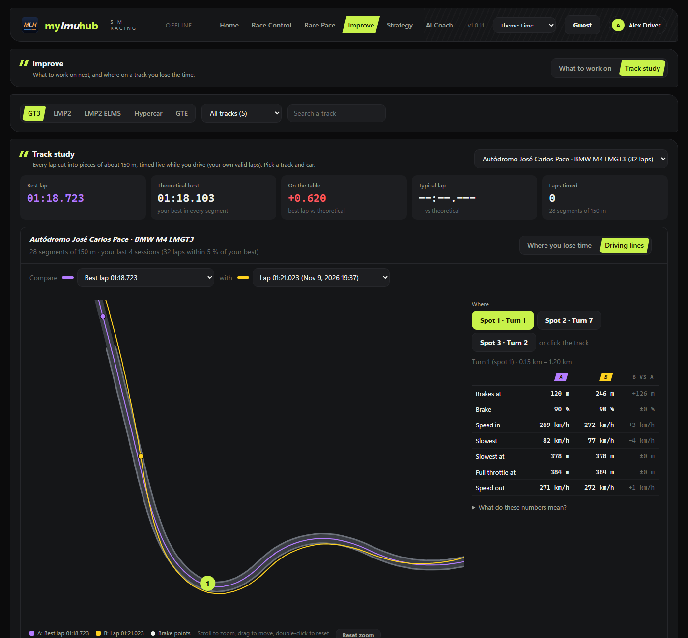

## AI Coach
Your own AI reads a summary of a session and writes a debrief with a plan for your next session, or answers your questions about it.
- **Your own API key:** Google Gemini (has a free tier), OpenAI or Anthropic (Claude). My LMU Hub has no AI or server of its own: requests go straight from your PC to that provider, with your key.
- **Only when you click:** nothing is sent by itself. Before each request you see roughly how big it is and can read exactly what is sent: lap and sector times, track, car, class, your weak spots and how you drive them. No names, no files.
- **Costs:** a paid key is billed by the provider to your account, usually less than a cent per debrief with a small model. Every answer is saved on your PC, so opening it again is free.
- **Your key stays on your PC,** stored encrypted for your Windows user.

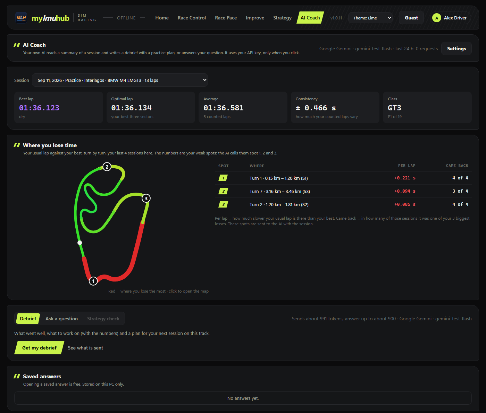


## Strategy
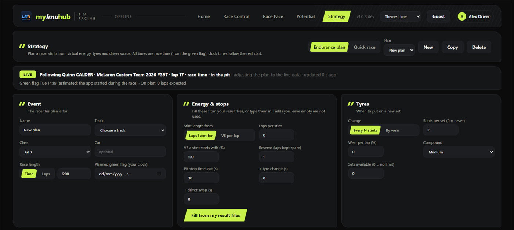

**Endurance planner:**
- **Plans:** several of them, each with its event (track, class, car, race length in time or laps, planned green flag).
- **Start from sessions you drove:** tick one or more races or practice sessions and say how you drove each (normal, saving VE, or mixed). It reads
  your pace, VE use and tyre wear per lap from them together, leaving out pit, out and incident laps and early stops for damage, and works out **what
  lifting costs you** from a normal and a saving session. The **suggested strategy** shows every stint length with the VE per lap it allows, how much
  more you'd have to save, the lap time, the stops and the laps in the race, and marks the best: until it knows what lifting costs, the best without
  extra lifting, and for each lifting option how cheap lifting must be to be worth it. **Plan this** fills the plan in one click.
- **Stints:** from laps or virtual energy per lap, start energy, spare laps, and the time lost to a pit stop, a tyre change and a driver swap.
  **Fill from my result files** takes your real numbers. A last stint that doesn't need a full refill can **save** (fill only what it needs) or **push**.
- **Tyres:** change every N stints or by wear, with the sets available and the compound.
- **Drivers:** driving order, lap time, most stints in a row, and most / least drive time each.
- **Your own data per lap:** while you drive, each lap keeps the VE it used and the tyre wear left (the game's online result files have neither).

**Live:** a live race-pace screen for the race you're in, with the plan you pick; your plan itself is never changed.
- **Status bar:** **YOU CAN PUSH**, **ON TARGET** or **LIFT** (the VE you have left against the laps to the planned stop at this stint's average, so one lap a bit over doesn't turn it red), when to pit, and the pit stop in **your local time**, so you know when to be at the computer.
- **This stint:** last lap, stint average and fastest lap, VE per lap and left, top speed, and every lap.
- **Damage: repair?** The top speed on the longest straight, taken every lap at a point where you're still flat out. When it drops, it shows how much, since which lap, the lap time it costs (the same driver before and after) and whether a repair at the next stop earns its time back. It works while spectating too, when the game doesn't show a team-mate's damage.
- **Drivers in this race:** stints, laps, drive time, average and fastest lap, VE per lap.
- **Changes to the plan:** the rest of the race for other stint lengths (VE per lap allowed, push or lift, stops, laps at the finish), the best marked. **Use this** follows one of them live.
- **The race:** stints done turn green; the rest is planned again from now with each driver's real lap times, slower on used tyres (how much is measured from the race), up to the real end: the leader's line after the time, then yours.

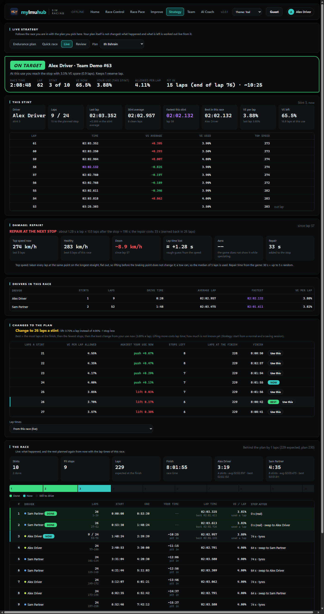

**Review:** a race you drove, afterwards: every stint (average, fastest lap, VE per lap, VE left, the stop and which tyres were changed), against the plan you had, what worked and what didn't, and what other stint lengths would have given.
A stint ends at a pit lap, and also where the driver changes or the energy is refilled when the game's file didn't mark the stop.

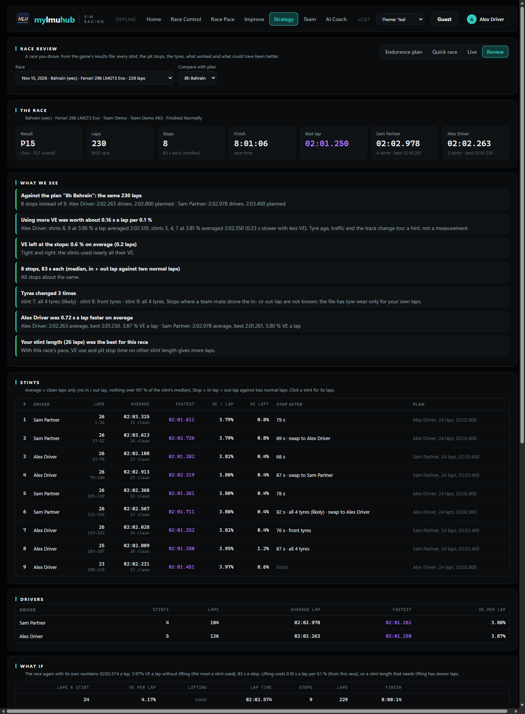

**Quick race:** paste the event text (e.g. from Discord). It reads the race length and the VE / fuel limits, takes the rest from the game, and gives the fewest stops with pit windows.

## Team
Your teams on a **team server**: invite codes, members with roles (driver, engineer, owner), one card per team with its logo.
- **Overview:** the team's pace on the last race's track, **team news** (who joined, which races came in), the race results.
- **Driver cards and profiles:** click a member for their roles, tracks, where they are fastest in the team, their steadiest car, their race pace per track
  (one class at a time, the cars of that class together) and their team races.
- **Team races, by themselves:** the app finds your special events (the game's scheduled endurance events, solo or with team-mates) in your result files and
  sends each to its team, recognised by the car's team name, the team's earlier races and team-mates in the car. A race left and rejoined several times is
  put back together from all its files. A race a team-mate already sent is not added twice.
- **Race results:** every team race as a card; click one for its **review** (stints, stops, tyres, drivers, what worked, what if), like the Strategy review.
- **Race pace:** everyone's race pace from all their sessions, by class and car: per track the best pace, the average team pace, the best quali lap and
  yours; per driver their average over their cars and which car was fastest, most consistent and best in race pace. A track you never raced together
  still shows what each of you drives there. Your app sends yours to each team by itself when it reads your results (and again when a team has none of it).
- **Strategy:** pick the team an event is for, then its drivers from a list (or type a name) with their lap times from the team race pace.
- When someone leaves, their personal data (race pace) goes; the races they drove with the team stay.
- **Live:** when a team-mate is racing, the Team tab says "Sam is in a race · View": their position, lap times, stint and virtual energy, with the car
  (every body part coloured by its damage, flat / missing tyres, suspension per wheel, a list of what is wrong) and the stints and laps of the session one click away. Your own sessions are shared with your teams only
  for team events (races of 2 h or more) by default; all sessions or off in Settings.
- Connecting to a team server, joining a team with its invite code and your first and last name as in the game: on the **Settings** page.
- **Team owners** rename the team (Team tab, Settings) and its members (Members: **Rename**), e.g. a first name only to the full name the game shows.
- **Team logo:** the owner picks a picture (Team tab, Settings); it shows on the team cards, next to the team's name and on the website. The app makes it a
  256 × 256 PNG, and the server checks it and keeps only its pixels (a new file made from them), so nothing hidden in a picture gets through.
- **Strategy plans** find a member's race pace by the name you type: the full name from the race results finds the member even when they joined with only a first name.

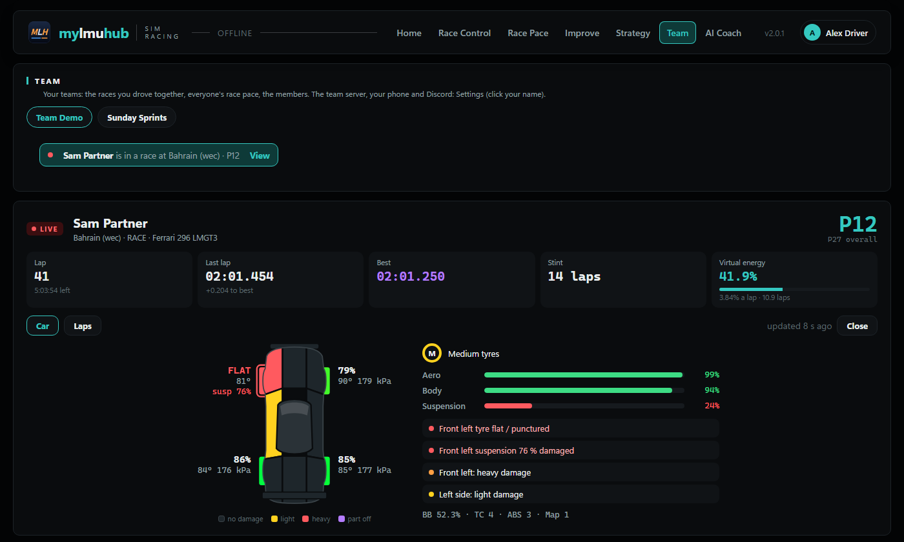

The team server is optional and you host it yourself (Docker behind a Cloudflare tunnel: [server/](server/README.md)). It only accepts invited members
and strictly checked numbers and short text, never files. Your login stays in the app, encrypted on your PC.

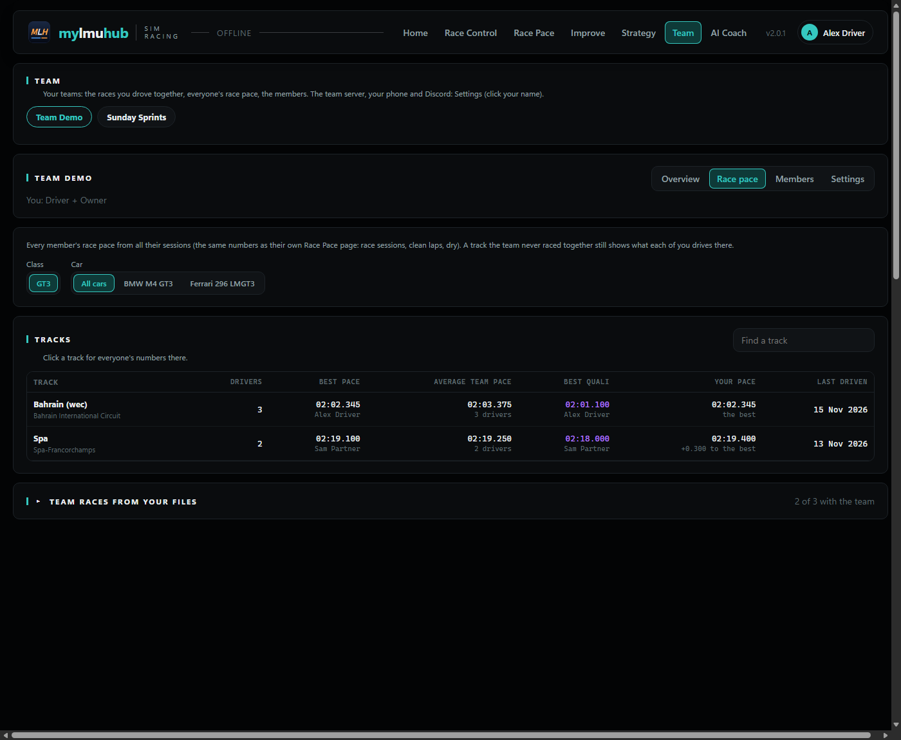

## On your phone
The team server is also a website, a **team portal** (e.g. **mylmuhub.com**), made for computers and phones. On a computer it has a sidebar (Home, Races,
Race pace, Live, Team, My stats) and Home is a dashboard: the last race, your level with a bar per track, the team's pace on the last race's track and the
team news; every member has a profile. On a phone it feels like an app: install it (Me page: **Install the app**,
or Share → Add to Home Screen on an iPhone) and it opens full screen with its own icon. Cards instead of wide tables, pull down to refresh, back returns to
where you were, and it opens without a connection too (it then says it's offline).
- **Log in with Discord** (link your Discord account once, in Settings) or with a **pairing code** from the desktop app (works once, for 2 minutes).
- **Home:** your team at a glance: the latest race, your race pace against the team's best on your last tracks. More than one team: pick it in the top bar.
- **Races:** every team race with its full review (stints, laps, what we see, what if). **Race pace:** everyone's pace per track and car. **Team:** the members and their profiles.
- **Live:** when a team-mate is racing, a banner says so on every page; tap it for their position, lap times, stint, virtual energy, the car and the laps.
  The car shows exactly what is wrong: every body part coloured by its damage, a flat or missing tyre, suspension damage per wheel, and a list ("Front left tyre flat", "Front left suspension 76 % damaged").
- **Me, your own stats:** the desktop app's Race Pace overview: per class, every track with your best lap and race pace against the alien times (Competitive, Good, ...), your level, cars, sessions and laps.
  Only you see them. The desktop app keeps them up to date by itself (Settings: *Keep my stats on the website*; off = deleted from the server).
- **The website can only look:** changes are only made in the desktop app. Log out every phone from Settings at any time.

<p align="center">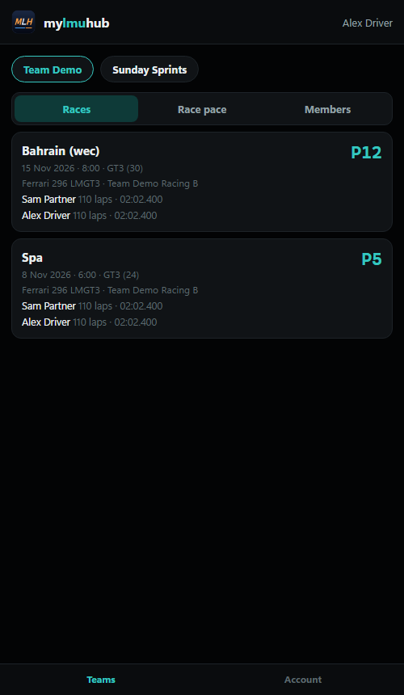 &nbsp; 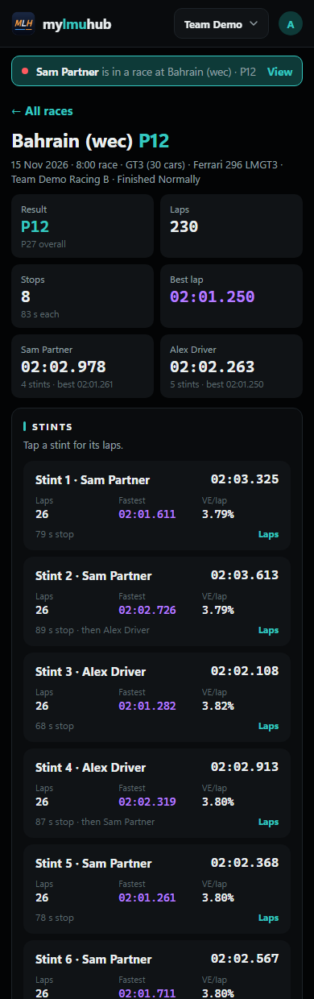 &nbsp; 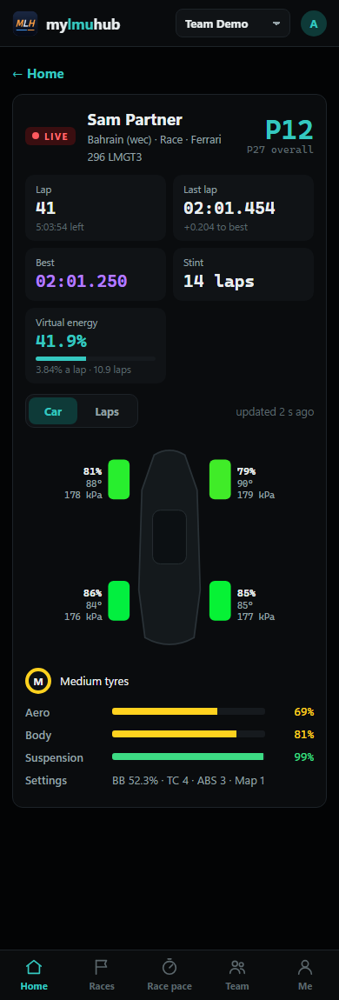</p>

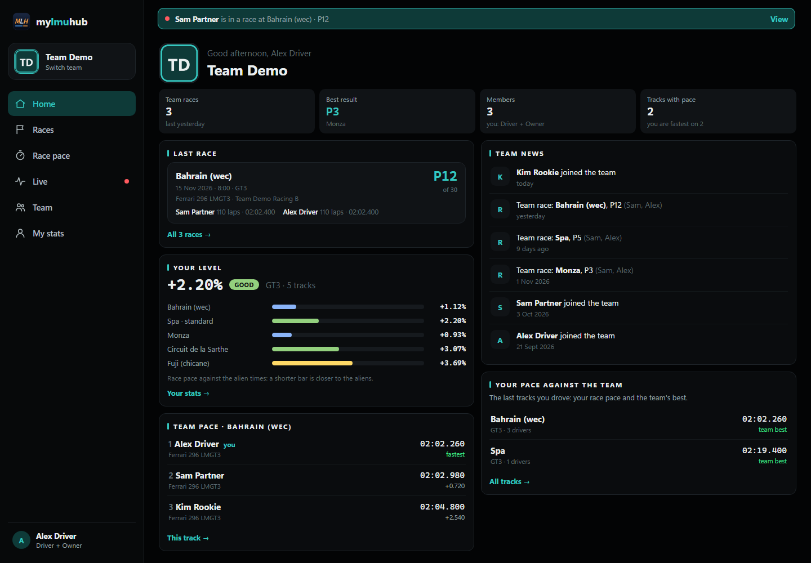

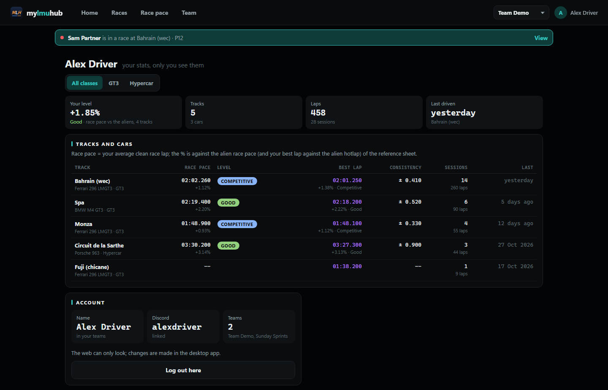

## Settings
Click your name in the top right: your **driver names** and results folder, **My sessions**, the **team server** (connect, join a team, your name in the
team, sharing your live sessions, your stats on the website), **your phone** (pairing code, Discord, log out all phones), **guest mode**, the **hub theme**
and **closing the window**: quit the app, or keep it running in the tray (next to the clock: it keeps reading the game, sharing your live data and listening to
your hotkeys; click its icon to open it again, right-click to quit).

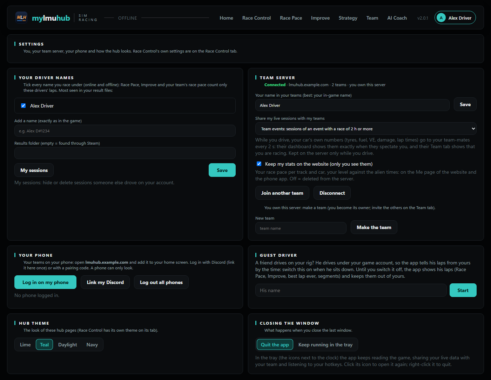

## Guest mode and My sessions
- **Guest mode** (Settings): a friend drives on your rig, on your account. Turn guest mode on with their name: they see their own data while they're there, and none of it mixes into your statistics. Their profile is kept: next time click **Drive again** and their data carries on. Or delete all of it in one click (files go to the Recycle Bin).
- **My sessions** (Settings): every result file with your laps. Tick the sessions someone else drove while guest mode was off, then hide them from your data, give them to a guest, take them back, restore them, or delete them.

## Everything else
- **Live and automatic:** Race Pace, Home, Improve and the best lap ever follow the session you're driving, without a restart.
- **Light on your PC:** the game's data is read straight from LMU's shared memory, with no SimHub or plugins. Only what changed is sent and redrawn, and nothing animates continuously.
- **Your names:** several driver names for yourself (the game shows them slightly differently sometimes), and your team-mates' names for spectator mode.
- **Network access:** the dashboard on other devices at home, on private networks only, after one Windows permission. Each view has its own address.
- **Hub themes:** Lime, Teal, Daylight and Navy (Settings).
- **Updates itself:** when a new version is out, the hub shows an update button with everything new since your version. Click the version number (top right) to look now. It downloads, checks and restarts; your settings and layouts stay.

## Getting started
1. Download **`MyLMUHub.exe`** from the [latest release](https://github.com/SKMots/MyLMUHub/releases/latest). Put it in a folder of your own, such as Documents\MyLMUHub (not Program Files: it updates itself there).
2. Start it. The hub opens. Click your name in the top right and enter your driver name(s) **exactly as in the game**.
3. Start Le Mans Ultimate and join a session. Click **Race Control**, then **Open dashboard**, and drag the window to your second monitor; **FULL SCREEN** (bottom right) or **F11** makes it full screen.

Needs Windows 10 or 11 with the Microsoft Edge WebView2 Runtime (already on Windows 11 and most Windows 10 PCs).
Settings live in `%AppData%\MyLMUHub`.

**Shortcuts:**
- **E** edits the layout.
- **F11** or the **FULL SCREEN** button (bottom right of the dashboard, next to HUB and SPECTATE) toggles full screen.
- **F12** opens the developer tools.

## Build it yourself
Requirements: Windows and the [.NET 8 SDK](https://dotnet.microsoft.com/download/dotnet/8.0).

```powershell
# run from source (needs the game running)
dotnet run --project src/MyLMUHub.App
# or build the single exe, like the releases
dotnet publish src/MyLMUHub.App/MyLMUHub.App.csproj -c Release -r win-x64 --self-contained true -p:PublishSingleFile=true -p:IncludeAllContentForSelfExtract=true -p:DebugType=none -o dist
```

A self-built exe doesn't update itself. **No .NET at all?** Open `src/MyLMUHub.App/wwwroot/index.html` in Chrome or Edge to see the dashboard on demo data; keys **1-5** switch the scenario.

### How it's put together
- **`MyLMUHub.Core`** (C#, no UI): reads the game's shared memory and turns it into numbers: standings, gaps, stints, pace and flags.
- **`MyLMUHub.App`** (WPF + WebView2): the windows, a small local web server with a WebSocket, auto-update and settings.
- **`wwwroot`** (plain JavaScript, no build step, no npm): every page and widget. All text formatting lives in `js/format.js`.
- **`server/`** (C#, .NET 10, optional): the team server.

"MyLMUHub" is the internal code name from the first version.

## Ideas, bugs and contributions
Ideas are very welcome: that's why this project is open source. Open an [issue](https://github.com/SKMots/MyLMUHub/issues) for a bug or a feature idea.
Pull requests are welcome too. Please keep them focused and keep the app light on CPU.

## Credits and notes
- Car-make logos are trademarks of their respective owners and are only used to identify the cars. The full-colour set comes from the open
  [car-logos-dataset](https://github.com/filippofilip95/car-logos-dataset).
- Reference lap times come from the community LMU laptimes sheet by Ohne Speed.
- Weather icons are based on [TinyPedal](https://github.com/s-victor/TinyPedal) (CC BY-SA 4.0).
- How to read the penalty types from the game was learned from [irdashies](https://github.com/tariknz/irdashies) (MIT).
- The driver names in the demo data are made up.
- Not affiliated with or endorsed by Studio 397 or Le Mans Ultimate. The game's SDK headers are not included.

## License
[MIT](LICENSE)
