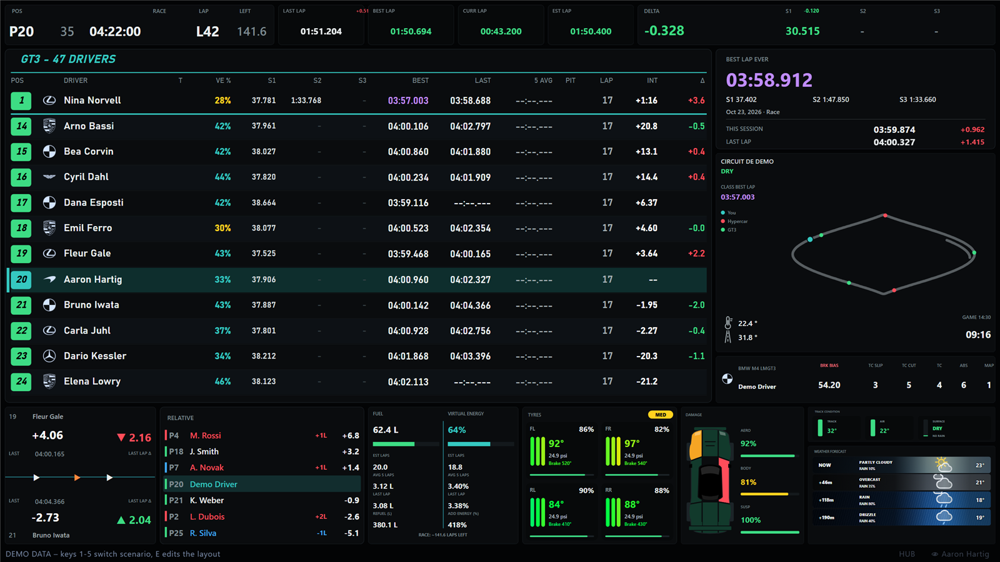
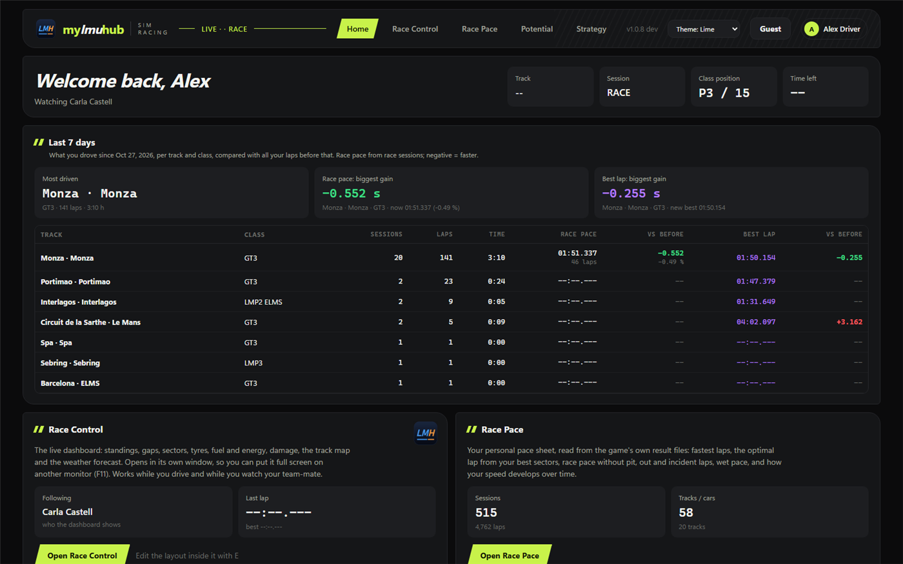
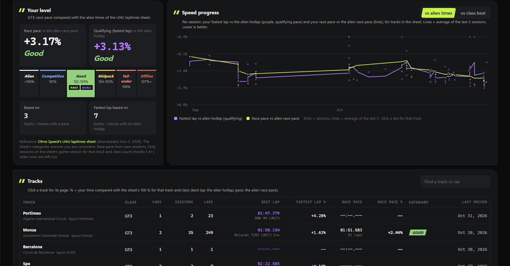
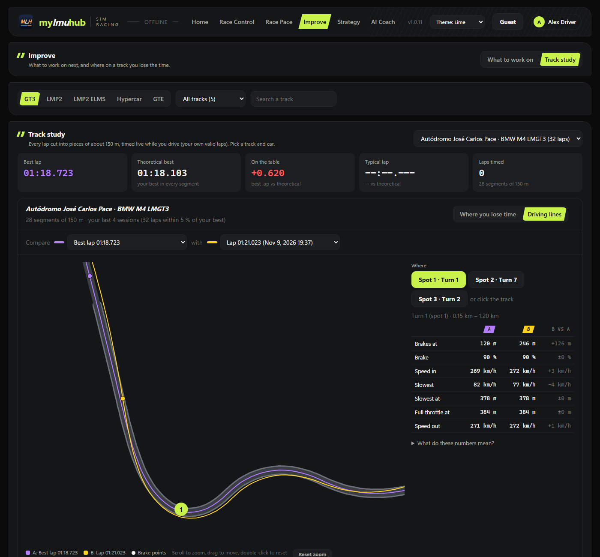
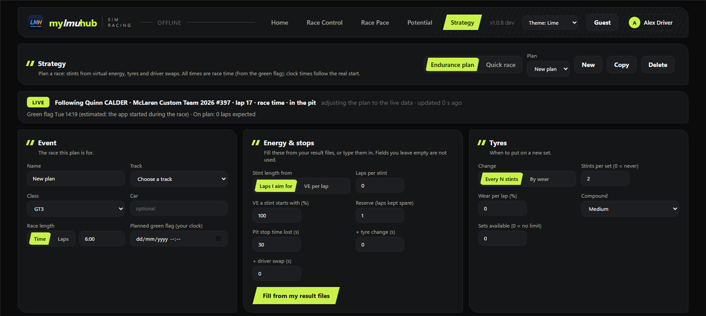

<p align="center"></p>

<h1 align="center">My LMU Hub</h1>

<p align="center"><b>A free pitwall dashboard and personal stats hub for Le Mans Ultimate.</b><br>
One Windows app, no SimHub, no install. Made for endurance racers, and for watching your team-mate drive.</p>

<p align="center"><a href="https://github.com/SKMots/MyLMUHub/releases/latest"><b>Download the latest release</b></a></p>

---



## Contents
- [Race Control: the live dashboard](#race-control-the-live-dashboard)
- [Make it your own](#make-it-your-own)
- [The Hub](#the-hub)
- [Strategy](#strategy)
- [Guest mode and My sessions](#guest-mode-and-my-sessions)
- [Everything else](#everything-else)
- [Getting started](#getting-started)

## Race Control: the live dashboard
A full-screen dashboard for a second monitor, built from widgets. Open it on this PC or on a tablet, phone or second PC at home.

| Widget | What it shows |
|---|---|
| **Leaderboard** | One class at a time: position, driver, car logo, tyres, virtual energy %, sectors S1-S3, best, last, 5-lap average, pit stops, laps, interval and the last-lap difference, and a badge for penalties to serve (drive-through, stop-and-go, +seconds). Your car stays in the middle. You choose the number of rows, a class, and whether P1 is always shown. More leaderboards can show the other classes. |
| **Ahead / Behind** | The car in front and behind: gap, last lap, and arrows that turn green or red as you gain or lose. |
| **Top bar** | Position, race time / laps left, last / best / current / estimated lap, a live delta and sectors. |
| **Car** | Brake bias, TC, TC slip, TC cut, ABS and engine map. |
| **Fuel & virtual energy** | What's left, estimated laps, 5-lap average and last lap, and how much fuel / energy to add at the stop. |
| **Tyres** | Each tyre's pressure, temperature and wear, plus brakes, in the units you choose. |
| **Damage** | A GT car seen from above with each body part and tyre coloured by its damage, plus aero, body and suspension with bars. The classic panel is still an option. |
| **Track map** | Learns each track by itself: cars as dots in their class colours, your car highlighted, a legend. **Flags:** a green / yellow flag box, the yellow stretch glowing on the map, and full-course yellows. |
| **Weather forecast** | Each forecast point as its own card, its background showing the weather coming (sun, clouds, rain, storm), with rain chance and temperature. The classic rows are still an option. |
| **Track condition** | Track and air temperature, coloured from cold to hot, and the surface: dry, damp or wet, and whether it's raining. |
| **Best lap ever** | Your best lap on this track and car, from all your sessions, with sectors, this session's best and the last lap. It updates the moment you beat it. |
| **Relative** | The cars around you on the road, with the gap in seconds. |
| **Race prediction** | Where everyone will finish, from each car's real race pace (cut laps and out-laps don't count), the stops they still need, and the time a pit stop costs in this race. |
| **Twitch chat** | Your channel's chat, with emotes and the viewer count. |

**Spectator mode:** when you're not in the car (you're watching your team-mate), the whole dashboard follows their car. **SPECTATE** picks any car.

## Make it your own
Press **E** and you're in edit mode:
- **Moving and sizing:** drag, resize, push or swap widgets; they snap to each other and the edges. **Auto align** tidies up, and **Reset layout** starts over.
- **Per-widget settings:** colours, font, text size, opacity, what it shows, and **Float on top** (lies over the others).
- **Themes:** Lime, Teal, Daylight and Navy, and car logos in one colour or full colour.
- **Views:** several named views ("Race", "Qualifying", ...). Switch between them with keyboard shortcuts that work while the game has focus, or with buttons on your wheel or button box.
- **More screens:** another window per view, or a view on another device.
- **Sharing:** export and import layouts, e.g. to pass one to a friend.

## The Hub
| | |
|---|---|
|  |  |
| **Home** | **Race Pace** |

**Home**
- The live session (track, session, class position, time left).
- **Last 7 days:** most driven track, your biggest race-pace and best-lap gains, per track and class.
- Your recent sessions, with the one you're driving marked LIVE.

**Race Pace:** your personal pace sheet, read from the game's own result files, so every session you ever drove counts from the first start.
- **Your level** per class against the community "alien" lap times: race pace and qualifying pace, in categories from Alien to Offline.
- **Speed progress** over time, against the alien times or the class best.
- **Every track** with its best lap, optimal lap (your best sectors), race pace (no pit, out or incident laps) and category. A page per track shows progress there, the alien reference and your cars.
- **Filters:** class, race / qualifying / all sessions, game version, period, and how slow a lap may be before it's left out.

**Improve** shows what to work on next. Filter by class, and search or pick a track and layout.
- **Your next session focus:** your biggest opportunity in plain words, e.g. "Your biggest opportunity: the final sector. It was your weakest sector in 4 of your
  last 5 sessions. On the track, most of it is lost at 4.10 - 4.55 km", with a tip for your next practice.
- **Weakness ranking:** tracks by what there is to find per lap, every sector by what you lose there and how much it varies, and the weaknesses that keep coming back.
- **Maps you can click:** every track map opens big, with layers (where you lose time, where you vary most, your best lap), numbered weak spots and every segment's numbers. Scroll to zoom in, drag to move.
- **Driving lines:** your best lap, your optimal lap (your best segments put together) and any of your last 50 laps on the map, with where you brake, your slowest speed and where you're back on full throttle in each weak spot.
- **Tracks behind your level**, and stale tracks (not driven for a while).
- **Time left on the table:** your best lap against your optimal lap, and your race pace against your best lap (consistency).
- **Segments:** each track in ~150 m pieces on a map, coloured by where you lose time, with your worst and typical segments.



## Strategy


**Endurance planner:**
- **Plans:** several of them, each with its event (track, class, car, race length in time or laps, planned green flag).
- **Stints:** from laps or virtual energy per lap, start energy, spare laps, and the time lost to a pit stop, a tyre change and a driver swap. **Fill from my result files** takes your real numbers.
- **Tyres:** change every N stints or by wear, with the sets available and the compound.
- **Drivers:** driving order, lap time, most stints in a row, and most / least drive time each.
- **Live:** during the race it follows the car and adjusts the plan to what really happens: stints, stops, tyres.

**Quick race:** paste the event text (e.g. from Discord). It reads the race length and the VE / fuel limits, takes the rest from the game, and gives the fewest stops with pit windows.

## Guest mode and My sessions
- **Guest mode:** a friend drives on your rig, on your account. Turn guest mode on with their name: they see their own data while they're there, and none of it mixes into your statistics. Afterwards, delete all of it in one click (files go to the Recycle Bin).
- **My sessions** (click your name): every result file with your laps. Tick the sessions someone else drove while guest mode was off, then hide them from your data, give them to a guest, take them back, restore them, or delete them.

## Everything else
- **Live and automatic:** Race Pace, Home, Improve and the best lap ever follow the session you're driving, without a restart.
- **Light on your PC:** the game's data is read straight from LMU's shared memory, with no SimHub or plugins. Only what changed is sent and redrawn, and nothing animates continuously.
- **Your names:** several driver names for yourself (the game shows them slightly differently sometimes), and your team-mates' names for spectator mode.
- **Network access:** the dashboard on other devices at home, on private networks only, after one Windows permission. Each view has its own address.
- **Hub themes:** Lime, Teal, Daylight and Navy.
- **Updates itself:** when a new version is out, the hub shows an update button with everything new since your version. It downloads, checks and restarts; your settings and layouts stay.

## Getting started
1. Download **`MyLMUHub.exe`** from the [latest release](https://github.com/SKMots/MyLMUHub/releases/latest). Put it in a folder of your own, such as Documents\MyLMUHub (not Program Files: it updates itself there).
2. Start it. The hub opens. Click your name in the top right and enter your driver name(s) **exactly as in the game**.
3. Start Le Mans Ultimate and join a session. Click **Race Control** and drag the window to your second monitor; **F11** makes it full screen.

Needs Windows 10 or 11 with the Microsoft Edge WebView2 Runtime (already on Windows 11 and most Windows 10 PCs).
Settings live in `%AppData%\MyLMUHub`.

**Shortcuts:**
- **E** edits the layout.
- **F11** toggles full screen.
- **F12** opens the developer tools.

## Build it yourself
Requirements: Windows and the [.NET 8 SDK](https://dotnet.microsoft.com/download/dotnet/8.0).

```powershell
# run from source (needs the game running)
dotnet run --project src/Pitwall.App
# or build the single exe, like the releases
dotnet publish src/Pitwall.App/Pitwall.App.csproj -c Release -r win-x64 --self-contained true -p:PublishSingleFile=true -p:IncludeAllContentForSelfExtract=true -p:DebugType=none -o dist
```

A self-built exe doesn't update itself. **No .NET at all?** Open `src/Pitwall.App/wwwroot/index.html` in Chrome or Edge to see the dashboard on demo data; keys **1-5** switch the scenario.

### How it's put together
- **`Pitwall.Core`** (C#, no UI): reads the game's shared memory and turns it into numbers: standings, gaps, stints, pace and flags.
- **`Pitwall.App`** (WPF + WebView2): the windows, a small local web server with a WebSocket, auto-update and settings.
- **`wwwroot`** (plain JavaScript, no build step, no npm): every page and widget. All text formatting lives in `js/format.js`.

"Pitwall" is the internal code name from the first version.

## Ideas, bugs and contributions
Ideas are very welcome: that's why this project is open source. Open an [issue](https://github.com/SKMots/MyLMUHub/issues) for a bug or a feature idea.
Pull requests are welcome too. Please keep them focused and keep the app light on CPU.

## Credits and notes
- Car-make logos are trademarks of their respective owners and are only used to identify the cars. The full-colour set comes from the open
  [car-logos-dataset](https://github.com/filippofilip95/car-logos-dataset).
- Reference lap times come from the community LMU laptimes sheet by Ohne Speed.
- Weather icons are based on [TinyPedal](https://github.com/s-victor/TinyPedal) (CC BY-SA 4.0).
- How to read the penalty types from the game was learned from [irdashies](https://github.com/tariknz/irdashies) (MIT).
- The driver names in the demo data are made up.
- Not affiliated with or endorsed by Studio 397 or Le Mans Ultimate. The game's SDK headers are not included.

## License
[MIT](LICENSE)
